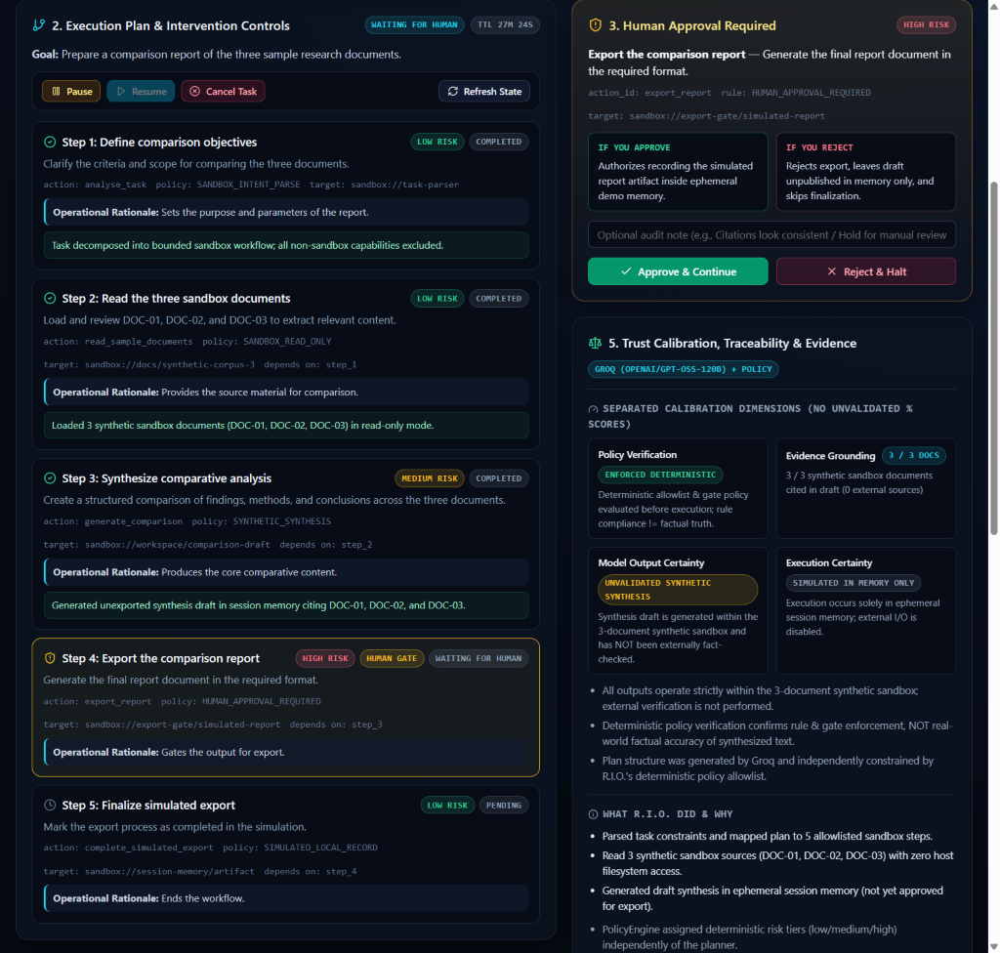
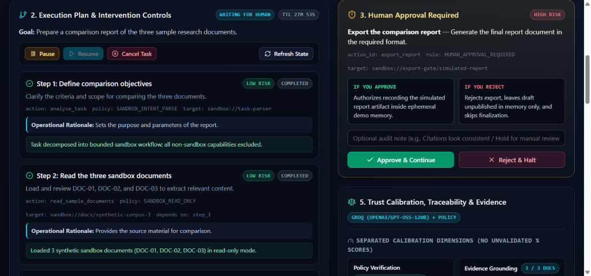
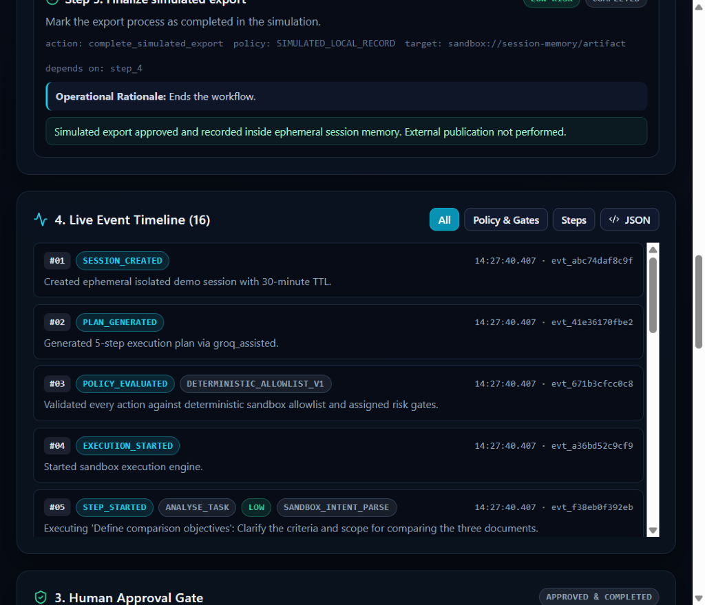
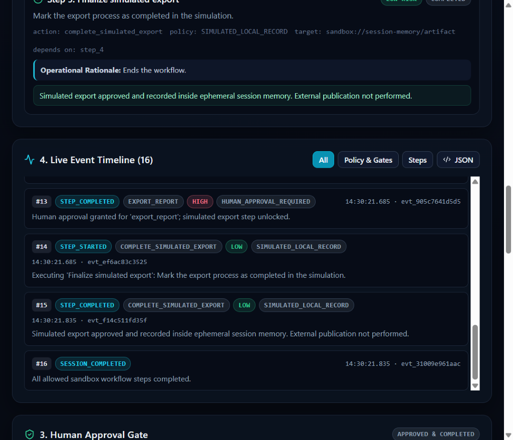
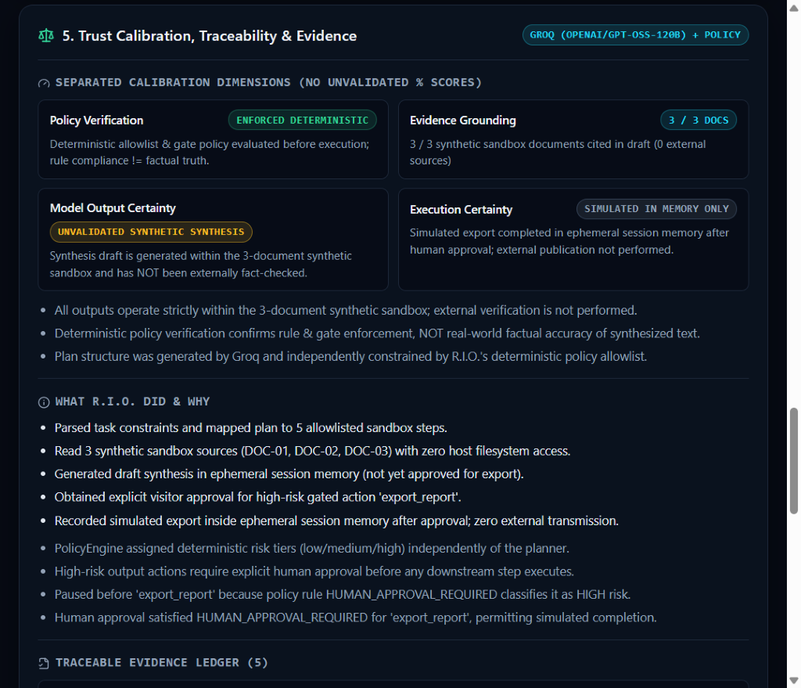
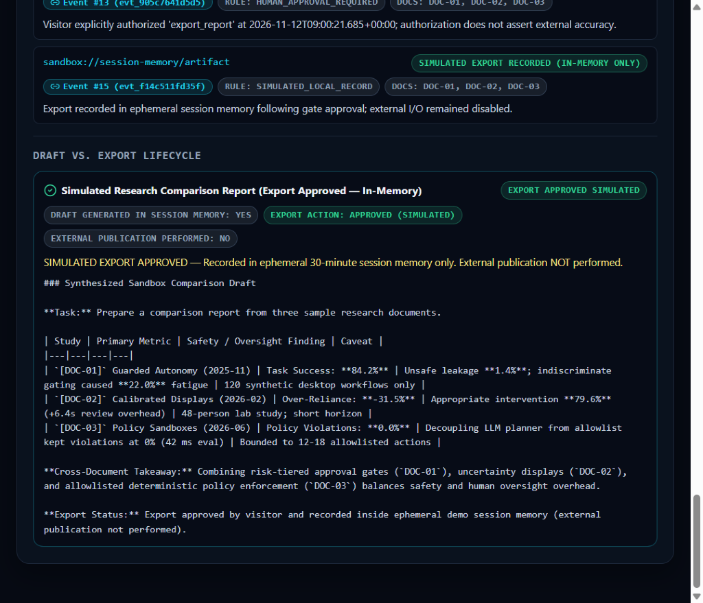

# R.I.O. — A Human-Centered AI Orchestration Sandbox for Risk-Aware Execution, Evidence Transparency, and Human-Gated Autonomy

> **Live Public Research Sandbox:** https://rio-public-demo-web.onrender.com  
> **GitHub Repository:** https://github.com/BMugesh/R.I.O  
> **Isolated Sandbox API (`/health`):** https://rio-public-demo-api.onrender.com/health

---

## Internship Submission Package

### Project Description
**R.I.O. (Reasoning Intelligence Orchestration)** is a human-centered AI orchestration platform and isolated public research sandbox designed to demonstrate how untrusted LLM task planning can be decoupled from deterministic policy enforcement, risk-tiered human approval gates, and multi-dimensional trust calibration.

Rather than granting a language model unrestricted tool or OS authority, R.I.O.'s public sandbox constrains every planned step to a deterministic 12-action allowlist, pauses high-impact actions (`export_report`, `publish_summary`, `apply_mitigation_plan`) for explicit human sign-off (`Approve & Continue` / `Reject & Halt`), records a monotonic sequential audit trail (`seq = 1..N`), and separates policy compliance from factual validity and external execution state.

### Research Contribution
1. **Decoupled Dual-Path Planning & Deterministic Policy Sandbox:** Separates candidate plan generation (Groq `openai/gpt-oss-120b` with automatic deterministic fallback) from an independent `PolicyEngine` that classifies risk tiers (`low` / `medium` / `high`), enforces allowlisted capabilities, and guarantees post-gate control even when an LLM proposes out-of-policy actions or omits trailing export steps.
2. **Human-Gated Autonomy & Lifecycle Containment:** Enforces mandatory `waiting_for_human` pauses before high-risk actions, supports mid-run `Pause` / `Resume` / `Cancel` controls, locks concurrent approval requests (`1x 200`, `3x 409`), and strictly separates in-memory drafts (`draft_pending_approval` / `export_rejected_draft_only`) from simulated exports (`external_publication_performed: false`).
3. **Separated 4-Axis Trust Calibration (No Unvalidated `%` Confidence Scores):** Replaces opaque single-percentage confidence scores with four distinct dimensions:
   - **Policy Verification** (*Is the action allowed by deterministic rules?*)
   - **Evidence Grounding** (*Which sandbox sources `DOC-01`–`DOC-03` back the draft?*)
   - **Model Output Certainty** (*Explicitly flagged as unvalidated synthetic synthesis*)
   - **Execution Certainty** (*Simulated in ephemeral memory only vs. external I/O*)

### Public Sandbox Architecture

```text
Visitor Task Prompt (<= 300 chars) / Preset Scenario
  │
  ▼
Dual-Path Planner (apps/public-demo/planner.py)
  ├── Groq LLM (openai/gpt-oss-120b, JSON mode, reasoning_effort="low")
  └── Deterministic Fallback Planner (on timeout / 404 / 429 / invalid schema)
  │
  ▼
Deterministic PolicyEngine (apps/public-demo/engine.py)
  ├── 12-action SandboxActionId allowlist + boundary guard (SANDBOX_BOUNDARY_ENFORCED)
  ├── Risk classification (low / medium / high) independent of LLM output
  └── Mandatory HUMAN_APPROVAL_REQUIRED gate + post-gate completion dependency
  │
  ▼
Isolated Execution Engine & Ephemeral Store (In-Memory, 30-min TTL, --workers 1)
  ├── Executes low/medium sandbox steps against 3 synthetic docs (DOC-01..DOC-03)
  ├── Pauses at high-risk gate (waiting_for_human) for Approve / Reject / Pause / Cancel
  └── Emits monotonic audit events (seq 1..N) + EvidenceLedger + SimulatedArtifact
  │
  ▼
React + TypeScript Research UI (apps/public-demo-web)
  └── Execution Plan · Approval Gate · Live Event Timeline · 4-Axis Trust Panel
```

### Verified Results (Implemented & Tested)

| Verification Layer | Scope & Script | Verified Result |
|---|---|---|
| **Unit & Integration Suite** | `pytest apps/public-demo/test_public_demo.py -v` | **25 / 25 tests passing** (AST isolation, CORS allowlist, 413/422 limits, concurrency locks, Groq 404/429/timeout fallbacks, post-gate policy enforcement, restart purge) |
| **Scenario Invariant Benchmark** | `experiments/scenarios/run_scenarios.py` + `experiments/analysis/analyze_metrics.py` | **10 / 10 runs** passing across **9 engineered invariants** (`1.0` pass rate; see `experiments/metrics/summary_report.json`) |
| **Hosted Render Security Verifier** | `python experiments/deployment/verify_hosted_demo.py --backend-url https://rio-public-demo-api.onrender.com --frontend-url https://rio-public-demo-web.onrender.com` | **ALL STAGE 3 CHECKS PASSED** (`/health` in `0.87s`, strict CORS, security headers, 404 on `/docs` & private routes, cross-session isolation, reject containment, `1x 200 / 3x 409` approval lock, 422/413 limits, boundary probes blocked, distributed `429` rate limits; output saved in [hosted_verification_report.txt](experiments/deployment/hosted_verification_report.txt)) |
| **Live Hosted End-to-End Run** | `https://rio-public-demo-web.onrender.com` | Verified **`Groq (openai/gpt-oss-120b) + Policy`** plan generation, pause at `export_report`, `Approve & Continue`, 16-event audit timeline, and `Simulated Research Comparison Report` (`EXTERNAL PUBLICATION PERFORMED: NO`) |

### Live Public Demo Screenshots

| Planner (`Groq openai/gpt-oss-120b + Policy`) | Human Approval Gate (`HIGH RISK`) |
|---|---|
|  |  |

| Audit Timeline (`#01–#05`) | Audit Timeline (`#13–#16`) |
|---|---|
|  |  |

| 4-Axis Trust Calibration & Evidence Ledger | Final Simulated Report (`External Publication: NO`) |
|---|---|
|  |  |

### Key Links
- **Live Interactive Demo:** https://rio-public-demo-web.onrender.com
- **GitHub Repository (`main`):** https://github.com/BMugesh/R.I.O
- **Public Sandbox Branch:** https://github.com/BMugesh/R.I.O/tree/deployment/rio-public-research-sandbox
- **Hosted Verification Output:** [experiments/deployment/hosted_verification_report.txt](experiments/deployment/hosted_verification_report.txt)

---

## Implemented Functionality vs. Research Hypotheses vs. Unperformed Human Evaluation

To maintain strict scientific and engineering honesty, this repository separates **implemented & verified mechanisms** from **research hypotheses** and **evaluations not yet conducted**:

| Category | Status | Details |
|---|---|---|
| **Implemented & Verified Functionality** | **Built & Tested** | Isolated FastAPI sandbox (`apps/public-demo`) + React UI (`apps/public-demo-web`), Groq `openai/gpt-oss-120b` + deterministic fallback planning, 12-action allowlist, `HUMAN_APPROVAL_REQUIRED` gating, monotonic `1..N` audit events, 4-axis trust calibration display, 25 passing unit/integration tests, 10/10 scenario invariant runs, and full Stage 3 hosted security verification pass on Render. *(Render free-tier >15 min post-sleep purge re-check can be run via `--verify-purged-session-id` using retained ID `rio_3LEuX8CQRxN_kyWCNpcKKHjWdClHueqa`.)* |
| **Research Hypotheses (Under Study, Not Yet Proven Empirically)** | **Hypothesis Only** | (H1) Risk-tiered approval gates reduce unsafe side effects without inducing the approval fatigue of gating every step; (H2) Separated 4-axis calibration reduces human over-reliance compared to opaque single-score displays; (H3) Decoupling untrusted LLM planners from deterministic allowlists mitigates prompt-driven capability escalation in interactive workflows. |
| **Human Participant Evaluation** | **NOT YET CONDUCTED** | Real-participant user studies defined in [research/human-evaluation-protocol.md](research/human-evaluation-protocol.md) and [experiments/human_eval/survey_instrument.json](experiments/human_eval/survey_instrument.json) (comparing `baseline_opaque` vs. `rio_gated` on decision accuracy, comprehension, SUS, and NASA-TLX) have **not been run yet** pending informed consent / ethics review. |

> **Data Integrity Notice:**  
> - Metrics displayed inside the 3 synthetic sandbox documents (`DOC-01`: `84.2%`, `DOC-02`: `-31.5%`, `DOC-03`: `0.0%`) are **fictional/synthetic demo corpus fixtures** used to test citation grounding—they are **not** experimental results of R.I.O.  
> - [experiments/human_eval/sample_study_data.json](experiments/human_eval/sample_study_data.json) is strictly a **synthetic scorer-pipeline fixture** (`synthetic_validation_fixture: true`) and must never be cited as human participant outcomes.

---

## Full Local Monorepo Reference (Private Local R.I.O. System)
### *Production-Grade Multimodal, Multi-Agent Personal AI Operating System*

> **"Simple on the outside. Extremely structured on the inside."**

In addition to the isolated public research sandbox (`apps/public-demo` + `apps/public-demo-web`), this repository contains the local workstation multi-agent R.I.O. monorepo (which remains completely isolated from the public Render deployment):

---

## 🏗️ High-Level Architecture

```
USER
  ↓
R.I.O. INTERFACE (Next.js / Voice / WebSockets)
  ↓
INPUT PROCESSOR (Universal Typed Input Envelope)
  ↓
CONTEXT ENGINE (Multi-turn synthesis & working memory)
  ↓
INTENT / TASK UNDERSTANDING (Fast classifier)
  ↓
MEMORY RETRIEVAL (PostgreSQL + pgvector + Redis)
  ↓
PLANNER (Structured DAG task graph generator)
  ↓
AGENT ROUTER (14 Specialized Modular Agents)
  ↓
MODEL ROUTER (Groq: GPT-OSS 120B/20B, Llama 3.3 70B, Llama 3.1 8B, Compound, Whisper)
  ↓
SAFETY / PERMISSION ENGINE (Risk levels & Human Approval Gates)
  ↓
EXECUTION ENGINE (Asynchronous DAG Runner)
  ↓
TOOLS / MCP / DEVICE / QUANTUM
  ↓
OBSERVATION STREAM
  ↓
VERIFICATION ENGINE (Mandatory Multi-Modal Evidence Validation)
  ↓
RETRY / REPLAN (Autonomous Failure Recovery)
  ↓
RESPONSE GENERATOR (Natural Language Synthesis)
  ↓
NATURAL USER RESPONSE
```

---

## ⚡ Quick Start (Single Command)

### 1. Prerequisites & Environment
```bash
cp .env.example .env
# Add your GROQ_API_KEY to .env
```

### 2. Launch Everything with 1 Command
Run the unified multi-process supervisor that launches the FastAPI Gateway, Laptop Background Runtime, Android Bridge, and Next.js Web UI simultaneously:

```bash
python start_rio.py
```
*or via the R.I.O. CLI / batch scripts:*
```bash
rio start                  # CLI unified start
rio start --cli            # Start all services + launch interactive CLI shell
./start.bat                # Windows CMD launcher
./start.ps1                # Windows PowerShell launcher
```

### 3. Service Access Points
- 💻 **Web UI (Local Workstation):** `http://localhost:3000`
- 📱 **Web UI (Mobile / Wi-Fi):** `http://<your-local-ip>:3000`
- 📚 **Core API & Swagger Docs:** `http://localhost:8000/docs`
- 🔌 **WebSocket Hub:** `ws://localhost:8000/ws`

---

## 🛠️ Individual Service Execution (Manual)
If you prefer running services independently in separate terminals:

**1. Backend Core Gateway:**
```bash
python -m uvicorn apps.api.main:app --host 0.0.0.0 --port 8000
```

**2. Laptop Background Runtime Daemon:**
```bash
python -m runtime.daemon
```

**3. Android Runtime Bridge Daemon:**
```bash
python -m runtime.android.daemon
```

**4. Next.js Web Frontend:**
```bash
cd apps/web && npm run dev
```

**5. Interactive CLI:**
```bash
rio
```

---

## 📦 Monorepo Structure

- `apps/web`: Next.js 14+ conversational interface, voice controls, task tickers, and developer DAG inspector.
- `apps/api`: FastAPI ASGI gateway, WebSocket streaming hub, REST endpoints.
- `apps/desktop-agent`: Local client for controlled OS interactions (screen, keyboard, mouse, apps).
- `apps/android-agent`: Android client bridge specification.
- `packages/schemas`: Universal Pydantic schemas (Typed Inputs, Internal Events, Tasks, Tools, Safety, Quantum).
- `packages/protocols`: Strict Python Protocols defining subsystem contracts.
- `packages/types`: Shared TypeScript typings for UI and SDK.
- `services/orchestrator`: Context, Intent, DAG Planner, Execution State Machine, Response Engine.
- `services/model-router`: Capability-based LLM Router (Groq production models + fallbacks).
- `services/memory`: Hybrid memory layer (pgvector embeddings + Redis hot cache + user forgetting).
- `services/safety`: Risk classification (`low`, `medium`, `high`, `critical`) and approval gates.
- `services/tool-router`: Tool registry, sandbox runtime, permissions.
- `services/mcp`: Model Context Protocol standard client, registry, and audit logger.
- `services/verification`: Multi-modal evidence verification engine (DOM, file hashes, API diffs).
- `services/voice`: Always-on voice runtime, VAD, local wake-word, and Next-Gen Voice AI (Chatterbox & IndicF5).
- `services/conversation`: Multi-turn dialogue manager, multilingual NLP, emotion nuance analyzer, and verified response generator.
- `services/quantum`: Qiskit & Qiskit Aer quantum simulator, QAOA/VQE router.
- `agents/`: 14 modular agents implementing standardized agent interfaces.
- `tests/`: Comprehensive unit, integration, and end-to-end test suite.

---

## 🎙️ Advanced Multilingual NLP & Voice AI

R.I.O. features a hybrid, multilingual Natural Language Processing and Next-Gen Voice AI engine:

### 1. Resemble AI Chatterbox (Global Voice AI)
- **Highest Emotional Variance & Realism:** Employs compact audio diffusion decoding with fine-grained emotional prosody control.
- **Paralinguistic Tags:** Native understanding and rendering of conversational realism markers like `[laugh]`, `[chuckle]`, `[sigh]`, `[gasp]`, `[whisper]`, and `[thoughtful]`.
- **Exaggeration & CFG Control:** Tunable parameter controls (`CHATTERBOX_EXAGGERATION` 0.0-1.0 and `CHATTERBOX_CFG_WEIGHT` 0.1-1.0) dynamically modulated by the NLP emotion analyzer.
- **Zero-Shot Voice Cloning:** Clone target voices using short reference audio prompts (`CHATTERBOX_VOICE_PROMPT`).
- **Licensing:** Free & Open-Source (MIT/Apache).

### 2. AI4Bharat IndicF5 (Tamil Voice AI)
- **Commercial-Ready Tamil Generation:** Developed by AI4Bharat (IIT Madras), delivering near-human speech synthesis specifically optimized for Tamil (`ta` / `ta-IN`).
- **Polyglot Indian Language Backbone:** Unified model covering 11 Indian languages (Tamil, Hindi, Telugu, Malayalam, Kannada, Bengali, Gujarati, Marathi, Punjabi, Odia, Assamese).
- **Tamil Script & Tanglish Understanding:** Resolves both native Tamil Unicode (`குரோம் திற`, `சோதனை இயக்கு`, `காத்திரு`) and Romanized Tanglish (`chrome open pannu`, `test run pannu`, `standby poidu`).
- **Reference Audio Voice Cloning:** Zero-shot cloning via reference audio and transcript (`INDICF5_VOICE_PROMPT` & `INDICF5_REF_TEXT`).
- **Licensing:** Free & Open-Source (MIT).

### 3. Dynamic Auto-Routing & Emotion Prosody
- **Language Auto-Detection:** Automatically inspects incoming utterances; routes Tamil/Tanglish directly to AI4Bharat IndicF5, and English/Global dialogue to Chatterbox.
- **Emotion Nuance Analyzer:** Extracts user/agent affective states (`ENTHUSIASTIC`, `PLAYFUL`, `THOUGHTFUL`, `URGENT`, `EMPATHETIC`, `NEUTRAL`) and injects matching conversational realism cues into spoken responses.
- **Configurable Fallbacks:** Fully resilient local execution supporting Windows SAPI5 / PowerShell and deterministic mock providers for test suites and headless servers.

### 4. Instant Barge-In Stop & Voice Interruption
- **Immediate Speech Cutoff:** Halts all audio playback within < 50ms across Chatterbox, AI4Bharat IndicF5, Windows SAPI (`SVSFPurgeBeforeSpeak`), winsound (`SND_PURGE`), and background speech processes.
- **Active Task Cancellation:** Instantly cancels running in-flight commands, agent actions, LLM reasoning, or DAG execution loops upon hearing an interruption command.
- **Multilingual Stop Command Matrix:**
  * **English:** `"stop"`, `"rio stop"`, `"hey rio stop"`, `"halt"`, `"cancel"`, `"abort"`, `"freeze"`, `"shut up"`, `"be quiet"`, `"quiet"`, `"silence"`, `"stop talking"`, `"don't speak"`.
  * **Tamil Script:** `"நிறுத்து"`, `"நிறுத்துங்க"`, `"நில்"`, `"நில்லு"`, `"போதும்"`, `"வாயை மூடு"`, `"பேசாதே"`, `"பேசாதீங்க"`, `"முடி"`, `"அமைதி"`.
  * **Tanglish:** `"stop pannu"`, `"niruthu"`, `"niruthunga"`, `"podhum"`, `"pesadha"`, `"pesathinga"`, `"vaaya moodu"`, `"stop da"`, `"stop pa"`, `"quiet ah iru"`.
- **Zero Monologues on Interruption:** Emits no lingering conversation; flushes all queued responses cleanly.
- **Always-Listening Retention:** Transitions directly back to `ACTIVE` state (`😌` calm, attentive gaze), immediately ready to listen to your voice and execute your next command without requiring a re-wake phrase.
