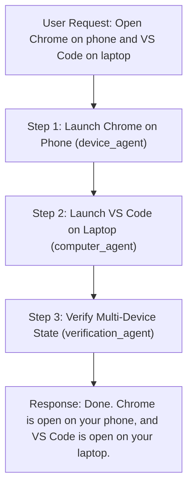

# R.I.O. — Multi-Device Routing & Execution Architecture

## 1. Overview

The **Device Router** (`services/device_router/router.py`) in R.I.O. is the central dispatch layer that resolves user intent, hardware capability requirements, and physical/virtual target device identities across the multi-device ecosystem.

---

## 2. Action to Capability Mapping

All natural-language commands and agent actions map to strongly-typed dot-notated capabilities defined in `DeviceCapability`:

| Action Pattern | Target Capability | Supported Platforms |
| :--- | :--- | :--- |
| `screenshot`, `screen.read`, `screen.capture` | `screen.read` | Windows, Android |
| `mouse_click`, `mouse.click`, `click` | `mouse.control` | Windows, Desktop |
| `type_text`, `send_message`, `keyboard_input` | `keyboard.control` | Windows, Desktop |
| `touch_tap`, `swipe`, `touch.control` | `touch.control` | Android, iOS |
| `open_application`, `launch_app`, `open.app` | `application.launch` | Windows, Android |
| `close_application`, `close.app` | `application.close` | Windows, Android |
| `browser_navigate`, `search_web` | `browser.control` | Windows, Desktop |
| `take_photo`, `camera.capture` | `camera.read` | Android |
| `microphone_record`, `voice_input` | `microphone.read` | Android, Windows |
| `read_notifications`, `notification.read` | `notifications.read`| Android |
| `send_notification`, `notification.send` | `notifications.send`| Android, Windows |
| `read_location`, `location.read` | `location.read` | Android |
| `read_sensors`, `sensors.read` | `sensors.read` | Android |

---

## 3. Security Boundary & Anti-RCE Safeguards

R.I.O. enforces strict runtime validation to prevent arbitrary remote code execution. Actions or parameters matching dangerous patterns are immediately rejected with a `Security Violation`:

* Prohibited Patterns: `eval(`, `exec(`, `os.system`, `subprocess.Popen`, `__import__`, `importlib`, `cmd.exe /c`, `powershell -enc`, `bash -c`.

---

## 4. Multi-Device Compound Execution DAG

When a user issues compound multi-device instructions (e.g. *"Open Chrome on my phone and VS Code on my laptop"*), the **DAG Planner** constructs a multi-agent dependency graph:

---

## 5. Verification & Observation Lifecycle

Every device action is acknowledged with a typed `DeviceObservation` containing:
* `status`: `"verified"`, `"uncertain"`, or `"failed"`
* `evidence`: Process ID, window title/handle, filesystem path, or Android package state
* Verification Engine rules evaluate evidence before marking a task step as `COMPLETED`.
